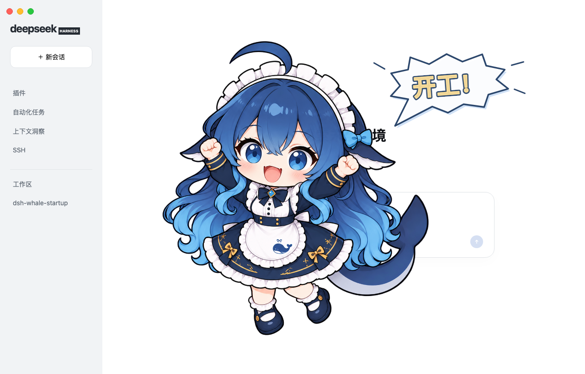

# 鲸鱼娘开场 · dsh-whale-startup

DeepSeek Harness 桌面端的独立开场动画插件：鲸鱼娘在原生加载页等候，工作台就绪后拍走加载提示、放大欢呼“开工！”，然后淡出消失。



[观看 4.2 秒演示](docs/preview.mp4)。图和视频为设计样片；安装后的底层界面是正在运行的真实工作台。

## 功能

- 保留原生 `HARNESS`、旋转圆环与加载状态，同步真实插件进度。
- 通过工作台 `shell.overlay` 的 React layout effect 确认提交完成，再播放退场。
- 原生失败提示保持可见；素材或就绪桥不可用时回退到原生界面。
- 独立运行，无需 `dsh-whale-widget` 等挂件插件。放大到画面中央欢呼后，自行清理并退出。
- 对白采用漫画气泡；“开工！”使用大号粗描边字和放射线。
- 不读取、隐藏、移动或修改其他挂件；它们继续按自己的设置运行。
- 遵循系统“减少动态”偏好，改为淡入淡出；默认无声音。
- 通过 dsh 原生插件机制加载，不修改应用包或签名，不增加模型提示或工具。

角色采用七个关键姿势的有限动画。演示视频的 60 fps 是输出采样帧率。

1.1.0 的结尾为：**拍走加载提示 → 居中放大 → 举手欢呼“开工！” → 淡出消失**。[更新记录](CHANGELOG.md)

## 安装

先克隆本仓库，或下载源码 ZIP 并解压。仓库已包含构建产物，安装前不需要下载依赖或重新构建。

```sh
gh repo clone chencujinlin/dsh-whale-startup
```

在 DeepSeek Harness 桌面端打开 **插件 → 添加插件 → 安装第三方插件**，输入克隆目录的绝对路径。确认 `dsh-whale-startup` 已启用后，退出并重新打开应用，使桌面壳重新收集启动注入。

本地目录安装可能使用链接，请保留该目录。在插件列表关闭插件即可停用；卸载后重启可清除桌面壳缓存的启动行。旧行的素材路由不可用时会安静回退，不阻断启动。

## 兼容性与验证

已在 macOS 的 DeepSeek Harness **0.2.1-rc.2** 上验证原生启动接入。其他平台未做实机验证。

插件使用 dsh 内部的 `webserver/index-inject`、`shell.overlay` 和 `[data-dsh-boot]` 接口，不使用其他挂件的 DOM。未来 dsh 版本改变这些接口时，需要重新验证。未检测到接入点时保留原生启动。

自动检查覆盖无挂件独立完成、居中放大、淡出清理、有无其他挂件时画布一致、其他挂件保持原样，以及持续加载、失败、工作台提交、就绪桥缺失、停用、减少动态和损坏素材回退；宿主检查覆盖注入去重、路由访问校验、GET/HEAD 与清理。

## 开发

构建使用 Python 3 标准库；宿主测试使用 Node.js 22 或更高版本。浏览器检查使用 Playwright 1.63.0。

```sh
python3 build.py
node --test tests/host.test.mjs
uv run --with 'playwright==1.63.0' playwright install chromium
uv run --with 'playwright==1.63.0' python tests/check_browser.py
# 导出演示，需要 ffmpeg 位于 PATH。
uv run --with 'playwright==1.63.0' python tools/render_preview.py --out qa/preview.mp4
```

| 文件 | 用途 |
| --- | --- |
| `src/bootstrap.js` | 动画运行时 |
| `lib/client.js` | 工作台提交信号桥 |
| `lib/index.js` | 启动注入与受宿主访问校验保护的只读素材路由 |
| `build.py` | 将七张角色 PNG 内嵌到 `lib/bootstrap.js` |
| `tools/render_preview.py` | 用同一生产绘制代码导出离线预览与演示视频 |
| `cordis.patch.yml` | 原生插件挂载声明 |

角色素材随包提供，运行时不访问外网。构建与安装不依赖本仓库之外的样片工程。检查产生的本机截图、安装记录和配置备份不属于仓库内容。

## 形象参考

造型与配色依据用户指定的两份参考，七姿势素材保存在 `assets/`。新增欢呼姿势由内置图像生成工具基于原角色生成，文件为 [`assets/cheer.png`](assets/cheer.png)，完整提示词为 [`docs/cheer-prompt.txt`](docs/cheer-prompt.txt)。

- [鲸鱼娘造型参考](https://xn--pssy23gqgbz2d718b.com/works/deepseek202610080017.html)
- [深蓝配色参考](https://xn--pssy23gqgbz2d718b.com/works/deepseek202610090006.html)
